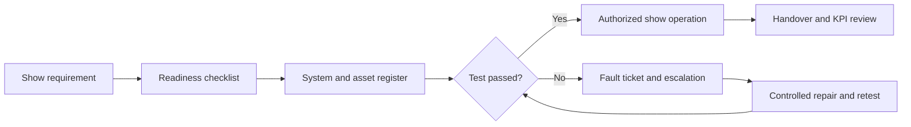

# Reference operating architecture — show-operations

**Illustrative system, not a ship's actual network.**

System boundaries: operations data, physical equipment, show control and organizational approval. No vessel IP addresses, access topology or proprietary configurations are represented.
